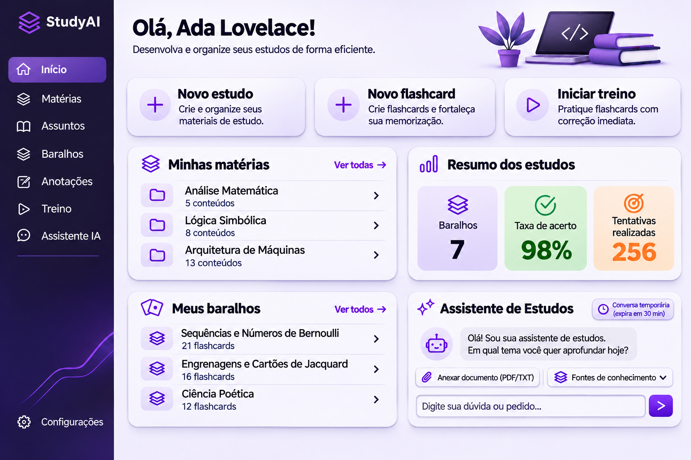

# Study Assistant AI

Study Assistant AI é uma aplicação backend para organização e apoio aos estudos, desenvolvida em **Java 21 e Spring Boot**.

A plataforma permite estruturar materiais de estudo, importar documentos, criar anotações, organizar flashcards, praticar respostas e acompanhar desempenho.

Recursos de **Inteligência Artificial** são integrados ao backend para geração de conteúdos e flashcards, avaliação de respostas e assistência ao estudo.

Utiliza **Retrieval-Augmented Generation (RAG)** para recuperar informações semanticamente relevantes dos conteúdos do usuário e utilizá-las como contexto nas operações de IA.

O **processamento documental**, a **geração de embeddings** e o **armazenamento vetorial** permitem transformar os materiais de estudo em fontes de conhecimento recuperáveis, preservando sua origem e rastreabilidade.

A arquitetura mantém as regras de negócio, autorização, isolamento de dados e persistência sob responsabilidade da aplicação. A IA atua somente nas operações em que sua utilização é explicitamente solicitada, sem acesso direto ao banco de dados.



---

## Funcionalidades

### Organização dos estudos

- Cadastro e autenticação de usuários;
- Organização de estudos em **matérias, tópicos e conteúdos**;
- Relacionamento hierárquico `Subject → Topic → Content`;
- Criação de anotações associadas a matérias, tópicos ou conteúdos;
- Isolamento dos dados entre usuários;
- Operações de criação, consulta, atualização e exclusão dos recursos;

### Importação e processamento de documentos

- Upload de documentos para extração de conteúdo textual;
- Visualização prévia do texto extraído;
- Criação de conteúdos de estudo a partir dos documentos processados mediante confirmação do usuário;
- Preservação das informações de origem dos conteúdos importados;
- Gerenciamento dos documentos associados aos conteúdos;

### Baralhos e flashcards

- Criação de baralhos temáticos em duas modalidades:
    - **Memorização (`STUDY`)**: memorização de conceitos com perguntas e respostas;
    - **Treino (`TRAINING`)**: prática de respostas com avaliação por IA;
- Criação manual de flashcards para memorização de conceitos;
- Geração de respostas com IA;
- Geração completa de perguntas e respostas com IA;
- Geração de múltiplos flashcards em uma solicitação;
- Utilização opcional de conteúdos, tópicos, contexto textual ou recuperação semântica para orientar a geração;
- Adição e remoção de flashcards em baralhos existentes;
- Conversão irreversível de baralhos de treino para memorização;
- Isolamento dos baralhos e flashcards por usuário;

O tema do baralho determina seu escopo conceitual e permanece independente da estrutura de matérias, tópicos e conteúdos.

### Treino

Baralhos da modalidade `TRAINING` permitem a prática de respostas utilizando flashcards gerados por IA.

Durante o treino:

- o usuário recebe uma pergunta sem visualizar previamente a resposta esperada;
- fornece uma resposta textual ou desiste da tentativa;
- quando uma resposta é fornecida, a IA a compara com a resposta esperada;
- o resultado é classificado como `CORRECT` ou `INCORRECT`;
- a tentativa é registrada individualmente como `AnswerAttempt`;

### Desempenho e revisões

O desempenho dos baralhos de treino é calculado a partir dos registros de `AnswerAttempt`, sem persistência duplicada das métricas durante sua utilização.

São calculados:

- total de tentativas;
- respostas corretas;
- respostas incorretas;
- percentual de acertos;

A necessidade de revisão também é derivada do histórico de tentativas.

Um flashcard é considerado pendente quando sua tentativa mais recente possui resultado `INCORRECT`. Uma tentativa posterior com resultado `CORRECT` remove essa pendência.

A aplicação também permite preservar o desempenho consolidado dos baralhos de treino por meio de registros de `DeckPerformanceHistory`, mantendo essas informações disponíveis independentemente da continuidade do baralho na modalidade de treino.

Os registros de histórico podem ser consultados e excluídos pelo usuário.

### Assistente de estudos

O assistente utiliza IA para:

- responder perguntas;
- esclarecer dúvidas;
- explicar conceitos;
- aprofundar assuntos;
- apresentar informações de outras formas;
- utilizar informações recuperadas dos conteúdos do usuário para fundamentar suas respostas;

As interações são independentes dos demais recursos da aplicação e não criam ou modificam automaticamente matérias, tópicos, conteúdos, anotações, baralhos, flashcards ou tentativas.

### Geração de conteúdos com IA

A aplicação permite gerar materiais de estudo a partir de:

- um tópico pertencente ao usuário;
- uma orientação textual opcional;
- informações recuperadas semanticamente dos conteúdos do usuário;

A IA retorna título e conteúdo textual.

O resultado permanece temporário até a aprovação explícita do usuário. Somente após essa aprovação o conteúdo é persistido e passa a se comportar como qualquer outro conteúdo da aplicação, preservando sua origem.

### Recuperação semântica e RAG

A aplicação utiliza **Retrieval-Augmented Generation (RAG)** para recuperar informações semanticamente relevantes dos conteúdos do usuário e utilizá-las como contexto nas operações de IA.

São disponibilizados os seguintes recursos:

- Segmentação dos conteúdos em fragmentos textuais (chunks);
- Geração de embeddings;
- Armazenamento e busca vetorial;
- Sincronização da indexação vetorial com a criação, atualização e exclusão dos conteúdos;
- Recuperação de informações por similaridade semântica;
- Seleção de fontes por matérias, tópicos ou conteúdos;
- Configuração da quantidade máxima de fragmentos recuperados e do limiar de similaridade;
- Isolamento das fontes recuperadas por usuário;

A seleção de fontes possui dois modos:

- **`PREFERRED`**: prioriza as fontes selecionadas, permitindo a utilização de conhecimento complementar pelo modelo;
- **`EXCLUSIVE`**: instrui o modelo a fundamentar o resultado exclusivamente nas fontes recuperadas;

O RAG está integrado à geração de conteúdos, à geração de flashcards e ao assistente de estudos.

---

## Arquitetura

A aplicação utiliza uma arquitetura em camadas, separando a exposição da API REST, as regras de negócio, a persistência, o processamento documental, a recuperação semântica e a integração com modelos de Inteligência Artificial.

```text
Client
  │
  ▼
REST API
  │
  ▼
Controllers
  │
  ▼
Services
  │
  ├──► Repositories ────────────────────► PostgreSQL
  │
  ├──► DocumentExtractionService ───────► Apache Tika
  │
  ├──► ContentVectorService
  │      ├──► ContentChunkingService
  │      ├──► VectorStore ──────────────► PostgreSQL / pgvector
  │      └──► JdbcTemplate ─────────────► PostgreSQL / pgvector
  │
  └──► AI Services
         │
         ├──► RagContextService
         │      ├──► RagPromptBuilder
         │      └──► SemanticRetrievalService
         │             ├──► SourceSelectionService
         │             ├──► EmbeddingModel
         │             └──► JdbcTemplate ──► PostgreSQL / pgvector
         │
         └──► GenerativeService ──► Spring AI / Ollama ──► LLM
```

A geração de embeddings durante a indexação e a recuperação semântica utiliza o modelo de embeddings integrado por meio do Spring AI e Ollama.

### Responsabilidades

**Controllers**

Expõem os endpoints REST, recebem as requisições e encaminham as operações para os serviços responsáveis.

**Services**

Concentram as regras de negócio, validações, autorização e coordenação das operações da aplicação.

**Repositories**

Abstraem o acesso aos dados persistidos no PostgreSQL por meio do Spring Data JPA e fornecem consultas utilizadas na aplicação das regras de isolamento multiusuário.

**Processamento documental**

Responsável pela extração textual, importação e gerenciamento dos documentos:

- `DocumentExtractionService`: extração de conteúdo textual utilizando Apache Tika.
- `DocumentService`: coordenação do processamento documental, criação dos conteúdos importados, preservação da proveniência e gerenciamento dos documentos.

**Indexação vetorial**

Responsável pela representação vetorial dos conteúdos e pela sincronização dos dados indexados:

- `ContentChunkingService`: segmentação dos conteúdos em fragmentos textuais (chunks).
- `ContentVectorService`: coordenação da indexação dos fragmentos, atualização e exclusão dos registros vetoriais associados aos conteúdos.

A indexação utiliza a abstração `VectorStore` do Spring AI para geração de embeddings e armazenamento vetorial. Operações específicas de consulta e exclusão dos registros utilizam `JdbcTemplate`.

**Recuperação semântica e RAG**

Responsável pela seleção, recuperação e preparação das informações utilizadas como contexto nas operações de IA:

- `SourceSelectionService`: validação da propriedade e da compatibilidade das fontes selecionadas.
- `SemanticRetrievalService`: geração do embedding da consulta e recuperação dos fragmentos por similaridade semântica, utilizando consultas SQL ao PostgreSQL com pgvector.
- `RagContextService`: coordenação da recuperação semântica e preparação do contexto recuperado.
- `RagPromptBuilder`: construção do contexto textual e das instruções relacionadas à utilização das fontes.

**AI Services**

Coordenam as funcionalidades de IA de acordo com suas responsabilidades:

- `ContentAiService`: geração de conteúdos de estudo.
- `FlashcardAiService`: geração de perguntas, respostas e flashcards.
- `AnswerEvaluationAiService`: avaliação das respostas fornecidas durante o treino.
- `StudyAssistantService`: interações com o assistente de estudos.

**GenerativeService**

Centraliza a comunicação com o modelo de linguagem utilizando Spring AI e Ollama, evitando que os serviços responsáveis pelas funcionalidades assumam diretamente essa integração.

### Persistência relacional e vetorial

A aplicação utiliza PostgreSQL para persistência dos dados relacionais e a extensão pgvector para armazenamento e recuperação das representações vetoriais dos conteúdos.

Os registros vetoriais possuem metadados que identificam:

- o usuário proprietário do conteúdo (`userId`);
- o conteúdo de origem (`contentId`);
- a posição do fragmento no conteúdo (`chunkIndex`).

Esses metadados permitem identificar a origem dos fragmentos, aplicar o isolamento multiusuário e sincronizar os registros vetoriais com os conteúdos persistidos.

---

## Modelo de domínio

A organização principal dos estudos segue a estrutura:

```text
User
 │
 ├── Subject
 │    │
 │    └── Topic
 │         │
 │         └── Content
 │
 ├── Document
 │
 ├── Note
 │
 ├── Deck
 │    │
 │    └── Flashcard
 │         │
 │         └── AnswerAttempt
 │
 └── DeckPerformanceHistory
```

### Organização dos conteúdos

```text
Subject 1 ─── N Topic
Topic   1 ─── N Content
```

Todo tópico pertence obrigatoriamente a uma matéria e todo conteúdo pertence obrigatoriamente a um tópico.

### Proveniência dos conteúdos

Todo conteúdo possui uma origem identificada pelo enum `ContentOrigin`:

- `MANUAL`: conteúdo criado manualmente pelo usuário;
- `AI_GENERATED`: conteúdo gerado com IA e aprovado pelo usuário;
- `DOCUMENT`: conteúdo criado a partir da importação de um documento;

A identificação da origem permite distinguir os diferentes processos de criação sem alterar a posição do conteúdo na estrutura hierárquica dos estudos.

### Documentos

```text
User     1 ─── N Document
Document 1 ─── N Content
```

A entidade `Document` armazena os seguintes metadados:

- nome original do arquivo;
- formato;
- tamanho em bytes;
- data e horário do upload;
- data e horário do processamento;
- quantidade de caracteres extraídos;


### Anotações

Cada `Note` pertence ao usuário e deve possuir exatamente um contexto:

```text
Subject
   OU
Topic
   OU
Content
```

Um usuário pode possuir no máximo uma anotação para cada contexto.

Quando o recurso associado é excluído, sua anotação também é removida, inclusive quando a exclusão ocorre em cascata.

### Baralhos

```text
User 1 ─── N Deck
Deck 1 ─── N Flashcard
```

`Deck` e `Flashcard` são estruturalmente independentes de `Subject`, `Topic` e `Content`.

Essa separação permite criar um baralho para qualquer tema sem exigir que exista previamente uma estrutura equivalente na organização dos estudos.

Matérias, tópicos e conteúdos podem, entretanto, ser utilizados como fontes de contexto para operações de geração com IA.

Todo baralho possui uma modalidade identificada pelo enum `DeckMode`:

- `STUDY`: memorização de conceitos;
- `TRAINING`: prática de respostas com avaliação por IA;

### Tentativas de resposta

```text
User      1 ─── N AnswerAttempt
Flashcard 1 ─── N AnswerAttempt
```

Cada `AnswerAttempt` representa uma tentativa individual de resposta durante o treino e armazena:

- usuário responsável pela tentativa;
- flashcard associado;
- resposta fornecida;
- resultado da tentativa;
- data e horário da tentativa;

O resultado é identificado pelo enum `AnswerAttemptResult`, podendo assumir os valores `CORRECT` ou `INCORRECT`.

Os registros constituem a base para o cálculo de desempenho e a identificação dos flashcards pendentes de revisão.

### Histórico de desempenho

```text
User 1 ─── N DeckPerformanceHistory
```

Cada `DeckPerformanceHistory` representa um registro consolidado do desempenho de um baralho de treino e armazena:

- identificador do baralho original;
- tema do baralho;
- total de tentativas;
- quantidade de respostas corretas;
- quantidade de respostas incorretas;
- percentual de acertos;

O identificador do baralho original (`originalDeckId`) é armazenado como um atributo, sem relacionamento referencial com a entidade `Deck`.

Essa independência permite preservar o histórico de desempenho mesmo após a conversão ou exclusão do baralho original.

### Representação vetorial dos conteúdos

Os conteúdos persistidos são representados adicionalmente por fragmentos textuais associados a embeddings, armazenados na estrutura vetorial do pgvector.

Essa representação constitui uma estrutura auxiliar de recuperação semântica, não uma entidade do modelo de domínio gerenciada pelo JPA.

A associação com os conteúdos de origem é realizada por meio dos metadados dos registros vetoriais, cuja consistência é mantida pelos serviços responsáveis pela indexação.

---

## Integração com Inteligência Artificial

A IA é tratada como uma capacidade integrada à aplicação, enquanto o backend permanece responsável pelo domínio.

A integração é realizada por meio do Spring AI e Ollama, utilizando dois modelos executados localmente e com responsabilidades distintas:

| Modelo | Responsabilidade |
|---|---|
| `qwen2.5:1.5b` | Geração textual e avaliação de respostas |
| `embeddinggemma` | Geração de representações vetoriais dos conteúdos e das consultas |

### Operações disponíveis

A aplicação utiliza IA para quatro responsabilidades principais:

| Operação | Responsabilidade | Integração com RAG |
|---|---|---|
| Assistente de estudos | Responder perguntas e auxiliar na compreensão de conceitos | Automática |
| Geração de conteúdo | Produzir materiais de estudo sujeitos à aprovação do usuário | Opcional |
| Geração de flashcards | Produzir perguntas e respostas dentro do escopo solicitado | Opcional |
| Avaliação de respostas | Comparar a resposta do usuário com a resposta esperada durante o treino | Não aplicável |

As operações são independentes e executadas somente quando solicitadas pelo usuário.

Uma operação de IA não inicia automaticamente outra operação, exceto quando esse encadeamento fizer parte explicitamente do fluxo solicitado.

### Fluxo de integração

```text
Usuário
   │
   ▼
Endpoint
   │
   ▼
Validação da operação
   │
   ▼
Resolução e validação do contexto
   │
   ├──► Recuperação semântica (quando aplicável)
   │          │
   │          └──► Fontes recuperadas
   │
   ▼
Construção do prompt
   │
   ▼
Serviço de IA
   │
   ▼
Modelo de linguagem
   │
   ▼
Tratamento do resultado
   │
   ▼
Regra de negócio / Persistência
```

Os prompts são construídos pela aplicação de acordo com a finalidade da operação, contexto fornecido pelo usuário e fontes recuperadas, conforme aplicável.

### Indexação dos conteúdos

Os conteúdos de estudo são segmentados em fragmentos textuais e convertidos em representações vetoriais.

```text
Content
   │
   ▼
Segmentação textual
   │
   ▼
Chunks
   │
   ▼
EmbeddingGemma
   │
   ▼
Embeddings
   │
   ▼
PostgreSQL / pgvector
```

Cada fragmento é armazenado com seu embedding e os metadados necessários para identificar o conteúdo de origem e seu proprietário.

A indexação utiliza vetores de 768 dimensões, índice HNSW e distância de cosseno.

### Retrieval-Augmented Generation (RAG)

O RAG permite incorporar informações dos conteúdos de estudo ao contexto fornecido ao modelo de linguagem, sem modificar seus parâmetros ou realizar treinamento adicional.

```text
Consulta
   │
   ▼
Validação das fontes selecionadas
   │
   ▼
Geração do embedding da consulta
   │
   ▼
Busca por similaridade semântica
   │
   ▼
Recuperação dos fragmentos relevantes
   │
   ▼
Construção do contexto
   │
   ▼
Integração das fontes ao prompt
   │
   ▼
Modelo de linguagem
```

A recuperação semântica considera exclusivamente os conteúdos pertencentes ao usuário autenticado.

A busca pode ser delimitada pelos seguintes parâmetros:

| Parâmetro | Finalidade |
|---|---|
| `subjectsIds` | Delimitar a busca por matérias |
| `topicsIds` | Delimitar a busca por tópicos |
| `contentsIds` | Delimitar a busca por conteúdos |
| `topK` | Definir a quantidade máxima de fragmentos recuperados |
| `similarityThreshold` | Definir o limiar mínimo de similaridade |
| `selectionMode` | Determinar o modo de utilização das fontes |

As fontes recuperadas são incorporadas ao prompt juntamente com suas informações de identificação, incluindo matéria, tópico, conteúdo e documento de origem, quando existente.

### Modos de seleção de fontes

- **PREFERRED**

Modo padrão de utilização das fontes.

O modelo é instruído a priorizar as informações recuperadas, podendo complementar o resultado com conhecimento geral e com o contexto fornecido pelo usuário.

A ausência de fontes relevantes não impede a execução da operação.

- **EXCLUSIVE**

O modelo é instruído a fundamentar o resultado exclusivamente nas fontes recuperadas.

Quando nenhuma fonte relevante é recuperada, a aplicação interrompe a operação e retorna HTTP 422 (`Unprocessable Content`).

Quando existem fontes, mas suas informações são insuficientes:

- na geração de conteúdos e assistente de estudos: o modelo é instruído a explicitar essa limitação sem complementar o resultado com conhecimento externo;
- na geração de flashcards: o modelo é instruído a sinalizar a insuficiência das fontes quando estas não sustentarem a quantidade solicitada, permitindo que a aplicação retorne HTTP 422;

**A restrição das fontes recuperadas é controlada pelo backend**. A utilização exclusiva dessas informações na geração textual é orientada por instruções incorporadas ao prompt.

### Rastreabilidade das fontes

As operações integradas ao RAG disponibilizam informações sobre as fontes recuperadas, permitindo identificar os conteúdos utilizados na construção do contexto fornecido ao modelo.

Essa rastreabilidade permite relacionar o resultado da operação aos materiais de estudo recuperados, sem estabelecer novos relacionamentos entre as entidades do domínio.

O modelo de linguagem não executa consultas diretamente ao banco de dados. A seleção, recuperação e disponibilização das informações são controladas pela aplicação.

---

## Segurança e isolamento de dados

A aplicação utiliza **Spring Security** e autenticação baseada em **JWT**.

As operações sobre recursos protegidos são executadas no contexto do usuário autenticado, garantindo o isolamento dos dados entre usuários.

### Autenticação e autorização

- Armazenamento de senhas protegidas por hashing com BCrypt;
- Autenticação baseada em tokens JWT;
- Validação do token nas requisições aos endpoints protegidos;
- Identificação do usuário autenticado a partir do contexto de segurança;
- Validação da propriedade dos recursos antes da execução das operações;

A autorização não depende exclusivamente da autenticação. A aplicação também verifica se os recursos envolvidos na operação pertencem ao usuário autenticado.

### Isolamento dos recursos

O isolamento multiusuário é aplicado a:

- matérias;
- tópicos;
- conteúdos;
- documentos;
- anotações;
- baralhos;
- flashcards;
- tentativas de resposta;
- históricos de desempenho;

O fornecimento do identificador de um recurso não implica autorização para acessá-lo ou modificá-lo.

### Isolamento da recuperação semântica

A recuperação semântica respeita os mesmos princípios de isolamento aplicados aos dados relacionais.

Os registros vetoriais possuem metadados que identificam o usuário proprietário e o conteúdo de origem.

Durante a recuperação:

- as matérias, os tópicos e os conteúdos selecionados são validados quanto à propriedade;
- a compatibilidade hierárquica entre as fontes selecionadas é verificada;
- as consultas vetoriais são restringidas ao usuário autenticado;
- os fragmentos recuperados respeitam os filtros de fontes aplicáveis à operação;

Os modos `PREFERRED` e `EXCLUSIVE` determinam a utilização das fontes recuperadas, sem alterar as regras de autorização e isolamento.

### Segurança na integração com IA

Os modelos de IA não possuem acesso direto ao banco de dados nem executam operações sobre os recursos da aplicação.

O backend controla quais informações são recuperadas e disponibilizadas ao modelo, sendo responsável pela validação das operações e pelo tratamento dos resultados.

As respostas produzidas pela IA não possuem autoridade sobre as regras de negócio. Qualquer operação que resulte em alterações nos dados permanece condicionada às validações e aos fluxos definidos pela aplicação.

---

## Regras de domínio relevantes

Algumas decisões do domínio possuem impacto direto sobre o comportamento da aplicação.

### Contexto dos flashcards

O tema do baralho determina o escopo conceitual utilizado na geração.

Matérias, tópicos, conteúdos, contexto textual e informações recuperadas semanticamente podem orientar a geração quando utilizados para essa finalidade.

Informações inseridas manualmente em outros flashcards não são utilizadas automaticamente como contexto para novas gerações.

### Modalidades de baralho

A modalidade do baralho determina as operações permitidas sobre seus flashcards.

Baralhos de memorização (`STUDY`) permitem a criação manual de flashcards e a geração parcial ou integral com auxílio de IA.

Baralhos de treino (`TRAINING`) são destinados à prática de respostas com avaliação por IA e possuem as seguintes restrições:

- somente flashcards gerados integralmente por IA podem ser adicionados;
- seus flashcards não podem ser alterados manualmente;
- as tentativas são preservadas para cálculo de desempenho e revisão;

### Conversão de baralhos

A conversão entre modalidades é unidirecional:

- baralhos de treino (`TRAINING`) podem ser convertidos em baralhos de memorização (`STUDY`);
- baralhos de memorização (`STUDY`) não podem ser convertidos em baralhos de treino (`TRAINING`);

Durante a conversão:

- os flashcards são preservados;
- o desempenho consolidado é preservado no histórico;
- as tentativas individuais de resposta são removidas;
- o baralho passa a seguir as regras da modalidade `STUDY`.

### Proveniência dos conteúdos

A origem de um conteúdo é determinada pelo seu processo de criação: manual, geração com IA ou importação de documento.

- a alteração posterior do conteúdo não modifica sua origem;
- conteúdos importados preservam a associação com o documento correspondente;
- a exclusão de um documento implica a exclusão dos conteúdos dele derivados;

Quando um conteúdo de origem documental é excluído, o documento correspondente também é removido caso não possua outros conteúdos associados.

---

## Tecnologias utilizadas

| Tecnologia | Utilização |
|---|---|
| Java 21 | Linguagem principal |
| Spring Boot | Estrutura e configuração da aplicação |
| Spring MVC | API REST |
| Spring Data JPA | Persistência e acesso aos dados relacionais |
| Hibernate | Mapeamento objeto-relacional (ORM) |
| Spring JDBC | Execução de consultas SQL para recuperação semântica |
| PostgreSQL 17 | Banco de dados relacional |
| pgvector | Armazenamento vetorial e busca por similaridade |
| Spring Security | Autenticação e autorização |
| JWT | Tokens de autenticação |
| Jakarta Bean Validation | Validação declarativa de dados |
| Apache Tika | Extração de texto de documentos |
| Spring AI | Integração com modelos de IA e armazenamento vetorial |
| Ollama | Execução local de modelos de IA |
| Qwen | LLM para geração textual e avaliação de respostas |
| EmbeddingGemma | Geração de embeddings |
| Docker | Execução da infraestrutura de banco de dados |
| Maven | Build e gerenciamento de dependências |
| JUnit 5 | Testes automatizados |
| Mockito | Simulação e isolamento de dependências em testes |

---

## Estratégia de testes

A aplicação utiliza JUnit 5 e Mockito para validação automatizada do comportamento do backend, abrangendo regras de negócio, integração entre componentes e consistência dos dados.

Para executar:

<small>Windows:</small>

```powershell
./mvnw.cmd test
```

<small>Linux/macOS:</small>

```bash
./mvnw test
```

### Testes unitários

Validam o comportamento dos serviços de forma isolada, utilizando mocks para simular suas dependências.

Os testes abrangem regras de domínio, validações, autorização, processamento documental, operações com IA e tratamento de exceções.

### Testes de integração

Validam a interação entre os componentes da aplicação e a infraestrutura de persistência, com ênfase na consistência transacional e na integridade dos dados.

| Classe de teste | Responsabilidade |
|---|---|
| `ContentVectorIntegrationTest` | Valida o rollback transacional de conteúdos e registros vetoriais em caso de falha na indexação. |
| `DocumentServiceIntegrationTest` | Valida o rollback da importação de documentos em caso de falha na persistência do conteúdo. |
| `PerformanceServiceIntegrationTest` | Valida a persistência do histórico de desempenho e a remoção das tentativas individuais de resposta. |
| `SemanticRetrievalIntegrationTest` | Valida a recuperação semântica com PostgreSQL e pgvector, incluindo filtros de fontes, metadados, limite de resultados, limiar de similaridade e isolamento multiusuário. |

As dependências de IA são simuladas nos cenários que exigem resultados determinísticos.

### Validação dos fluxos da API

Além dos testes automatizados, há o arquivo [`requests.http`](requests.http) que reúne requisições HTTP organizadas em fluxos lógicos de comportamento.

Esses fluxos permitem explorar e validar os recursos da aplicação, desde o cadastro e a autenticação até as operações de gerenciamento dos materiais de estudo, geração com IA, recuperação semântica e acompanhamento de desempenho.

O arquivo contempla tanto cenários de sucesso quanto cenários de erro, incluindo violações de regras de negócio e tentativas de acesso a recursos de outros usuários.

Cada requisição identifica o recurso acessado, o comportamento executado e o HTTP status code esperado.

<small>Exemplo de validação do isolamento entre usuários:</small>

```http
### Matéria - Impedir que User2 consulte matéria de estudo de User1 (404)
GET http://localhost:8080/api/subjects/{{materiaUser1}}
Authorization: Bearer {{tokenUser2}}
```

Os fluxos são parametrizados por meio de variáveis globais preenchidas dinamicamente a partir das respostas das requisições, permitindo o encadeamento das operações sem a necessidade de substituir manualmente identificadores e tokens de autenticação.

Além de auxiliar na validação funcional, o arquivo serve como documentação prática de utilização da API.

---

## Ambiente de desenvolvimento e execução

### Pré-requisitos

Para executar a aplicação localmente, são necessários:

- JDK 21;
- Docker com Docker Compose;
- Ollama instalado e em execução;
- configuração das variáveis de ambiente para conexão com o PostgreSQL e assinatura dos tokens JWT;

### Modelos de IA

Para disponibilizar os modelos utilizados pela aplicação:

```bash
ollama pull qwen2.5:1.5b
ollama pull embeddinggemma
```

### Banco de dados

O PostgreSQL 17 é executado em container Docker, utilizando uma imagem com suporte à extensão pgvector.

Para iniciar a infraestrutura, execute no terminal, a partir da raiz do projeto:

```bash
docker compose up -d
```

### Executar a aplicação

Com o PostgreSQL e Ollama em execução e as variáveis de ambiente configuradas, iniciar o backend utilizando o Maven Wrapper:

<small>Windows:</small>

```powershell
./mvnw.cmd spring-boot:run
```

<small>Linux/macOS:</small>

```bash
./mvnw spring-boot:run
```

A API estará disponível em:

```text
http://localhost:8080
```

---

## Exemplos de utilização da API

O arquivo [`requests.http`](requests.http) pode ser utilizado para executar e validar os principais fluxos da aplicação.

As requisições podem ser executadas diretamente pelo HTTP Client do IntelliJ IDEA.

As requisições estão organizadas em uma sequência que demonstra operações CRUD, relacionamentos entre entidades, autenticação, isolamento multiusuário, funcionalidades de IA, regras de domínio e cenários de erro.

---

## Princípios técnicos

As principais decisões técnicas da aplicação são:

- **Backend como responsável pelo domínio:** regras de negócio, validações, autorização e persistência permanecem sob controle da aplicação, sem delegação dessas responsabilidades aos modelos de IA;
- **Desacoplamento da inteligência artificial:** a comunicação com os modelos é centralizada e separada das regras de negócio, permitindo evoluir a integração com IA sem reestruturar o domínio;
- **Segurança e isolamento multiusuário:** a identidade autenticada determina o acesso aos recursos e às fontes de conhecimento utilizadas nas operações de IA;
- **Consistência e integridade dos dados:** as operações de persistência respeitam as regras de domínio e a consistência transacional entre os dados relacionais e suas representações vetoriais;
- **Rastreabilidade das informações:** a recuperação semântica preserva a identificação dos conteúdos de origem, permitindo identificar as fontes utilizadas nas operações com RAG;
- **Separação de responsabilidades:** a arquitetura mantém responsabilidades distintas entre domínio, persistência, processamento documental, recuperação semântica e integração com IA;
